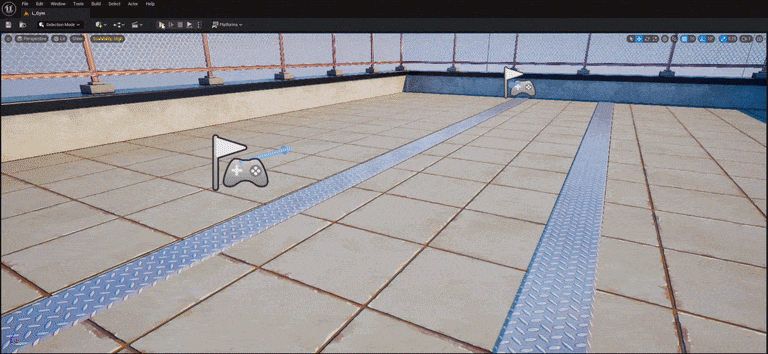
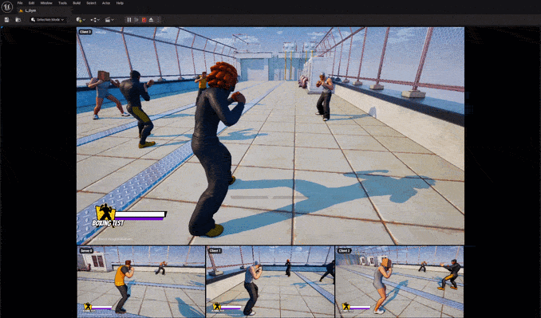

# Bacon PIE Grid

Unreal Engine 5.5 editor plugin that docks multiplayer PIE clients over the play viewport, either as an even grid or as a carousel with one main view and smaller views below it. Clients that open in their own windows are tiled onto the same grid, and you can switch between clients with Ctrl+Tab.

## Features

- Docks in-process PIE clients over the play viewport when you play in "Selected Viewport" with more than one client.
- Two view modes for docked clients:
  - Grid: an even grid that picks a near-square layout automatically, or uses a fixed number of columns.
  - Carousel: the first client fills a main view, and the others play in a row of smaller views below it, each the same shape as the main view.
- Tiles client windows onto the grid cells: separate-process clients (Run Under One Process off), Standalone Game, and PIE clients that aren't docked.
- Can letterbox every client to a fixed aspect ratio, such as 16 : 9.
- Can size the grid against the level editor's panel area instead of the play viewport. The editor layout is put back when play stops.
- Client switcher: hold Ctrl and tap Tab to move the highlight, then release Ctrl to switch. Shift goes backwards and Escape cancels. In the carousel, the client you switch to moves into the main view.
- Docked play starts with focus on the first client, usually the server. It keeps focus until you switch to another client, even when the other clients' game code takes focus as they spawn.

## Installation

1. Clone or copy this repository into your project as `Plugins/BaconPIEGrid`.
2. Regenerate project files and build the editor.

The plugin hooks into PIE through its own editor engine class. Its `Config/Engine.ini` sets `UnrealEdEngine` while the plugin is enabled, so there's nothing to add to your project's config, and disabling the plugin puts the default editor engine back. Only one editor engine class can be active, so it can't be combined with another plugin or project that sets its own `UnrealEdEngine`.

## Settings

Editor Preferences > Level Editor > PIE Grid. Settings are saved per user.

| Setting | Default | What it does |
|---|---|---|
| Dock Clients | On | Docks in-process clients over the play viewport. Applies to "Selected Viewport" play with more than one client. With it off, the first client stays in the level viewport, shrunk to the first cell, and the other client windows follow the viewport as it moves or resizes. Client windows that aren't docked are always placed on the grid cells. |
| View Mode | Grid | How docked clients are laid out: Grid or Carousel. Client windows that aren't docked always use the grid. |
| Carousel Height Ratio | 0.25 | Carousel only. Share of the grid's height taken by the row of smaller views below the main view. |
| Play Screen Size Ratio | Off, 1 : 1 | When ticked, sizes the grid against this width : height share of the level editor's panel area instead of the play viewport. Below 1, the panels next to the play viewport are pushed aside to make room. 1 : 1 covers the whole panel area, with the panels and drawers hidden behind the grid. |
| Columns | 0 | Number of grid columns. 0 picks the layout automatically. The carousel doesn't use it. |
| Cell Padding | 2 | Space around each cell. |
| Client Aspect Ratio | Off, 16 : 9 | When ticked, letterboxes every client to this width : height inside its cell. Separate-process windows get the same shape. |
| Show Cell Labels | On | Labels each cell with its client, such as "Server 0" or "Client 1". |
| Switch Client Chord | Ctrl+Tab | Shortcut for the client switcher. |

## License

MIT. See [LICENSE](LICENSE).
